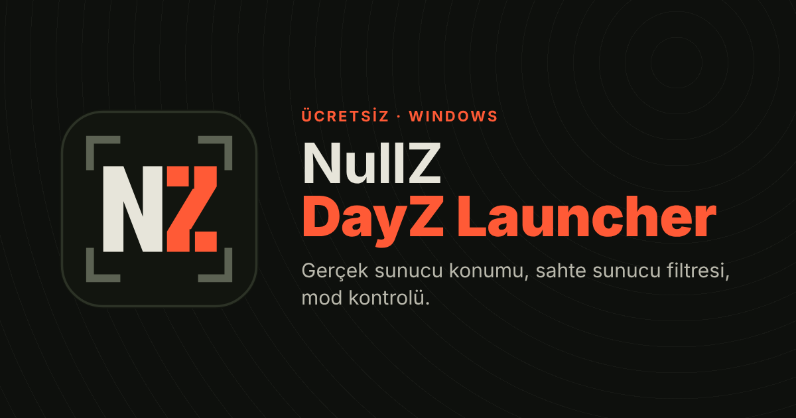
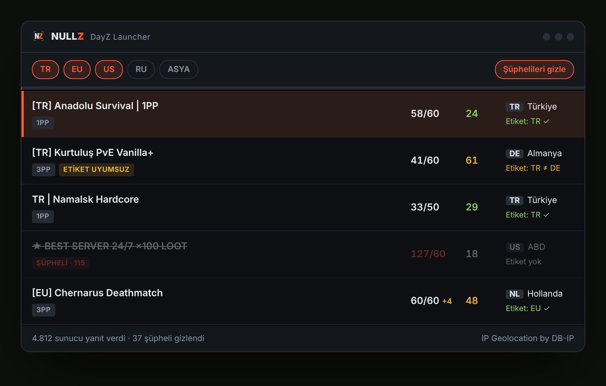

<p align="center">
  
</p>

<p align="center">
  <a href="https://github.com/KULLANICI/NullZ-Launcher/releases/latest"></a>
  <a href="https://github.com/KULLANICI/NullZ-Launcher/releases"></a>
  <a href="VIRUSTOTAL_LINKI"></a>
  
</p>

<p align="center">
  <b>Ücretsiz ve Türkçe DayZ launcher.</b><br>
  Sunucuların gerçek konumunu gösterir, sahte sunucuları gizler, modlu sunuculara tek tıkla bağlar.
</p>

<p align="center">
  <a href="https://github.com/KULLANICI/NullZ-Launcher/releases/latest"><b>⬇ Son sürümü indir</b></a>
  &nbsp;·&nbsp;
  <a href="https://SITEADRESIN.netlify.app">Web sitesi</a>
  &nbsp;·&nbsp;
  <a href="https://github.com/KULLANICI/NullZ-Launcher/issues">Hata bildir</a>
</p>

---



## Özellikler

| | |
|---|---|
| **Gerçek konum** | Her sunucunun IP adresinden hangi ülkede olduğunu bulur. |
| **Etiket kontrolü** | Adında `[TR]`, `EU`, `US` yazan sunucunun gerçekten orada olup olmadığını gösterir. Örnek: *"Adı TR diyor, sunucu Almanya'da."* |
| **Bölge taraması** | Sadece seçtiğin bölgeleri tarar: TR, EU, US, RU, Asya, diğer. |
| **Sahte sunucu filtresi** | Oyuncu sayısını şişiren, bot bildiren ya da Steam kaydıyla çelişen sunucular şüphe puanı alır ve gizlenir. Gerekçesi detayda yazar. |
| **Mod kontrolü** | Sunucunun mod listesini okur, hangi modların eksik olduğunu ve ne kadar ineceğini gösterir. Workshop sayfalarını tek tıkla açar. |
| **Tek tıkla bağlanma** | Oyunu Steam üzerinden, BattlEye ile normal şekilde başlatır. |
| **Discord durumu** | Discord profilinde hangi sunucuda oynadığını gösterir. İstersen kapatabilirsin. |
| **Diğerleri** | Favoriler, ping renkleri, ülke filtresi, 1PP filtresi, sürüm uyumsuzluğu uyarısı. |

## İndirme ve kurulum

1. **[Releases](https://github.com/KULLANICI/NullZ-Launcher/releases/latest)** sayfasından `NullZLauncher-x.x.x.zip` dosyasını indir.
2. Zip'i aç ve `NullZLauncher.exe`'yi çalıştır. Kurulum gerekmez, .NET yüklemene de gerek yok.
3. İlk açılışta **Ayarlar**'a ücretsiz Steam Web API anahtarını gir. Anahtarı [steamcommunity.com/dev/apikey](https://steamcommunity.com/dev/apikey) adresinden alabilirsin, alan adı kısmına herhangi bir şey yazman yeterli.
4. Bölgeni seç, **Tara**'ya bas ve sunucuya çift tıkla.

**Gereksinimler:** Windows 10 veya 11 (64-bit), Steam ve DayZ.

## Güvenlik

Her sürüm VirusTotal'da taranır, sonucu ve dosya özeti aşağıda yer alır.

| Sürüm | Dosya | VirusTotal | SHA-256 |
|---|---|---|---|
| v0.1.0 | `NullZLauncher.exe` | [0/72](VIRUSTOTAL_LINKI) | `SHA256_BURAYA` |

İndirdiğin dosyanın değiştirilmediğini doğrulamak için PowerShell'de şunu çalıştır. Çıkan değer tablodakiyle aynı olmalı:

```powershell
Get-FileHash .\NullZLauncher.exe -Algorithm SHA256
```

<details>
<summary><b>Windows "bilinmeyen yayıncı" uyarısı veriyor</b></summary>

SmartScreen, kod imzalama sertifikası olmayan yeni programlarda bu uyarıyı gösterir. **Ek bilgi → Yine de çalıştır** ile açabilirsin. İndirme sayısı arttıkça uyarı kendiliğinden kalkar.
</details>

<details>
<summary><b>Bir antivirüs programı dosyayı işaretledi</b></summary>

Tek dosya halinde paketlenmiş .NET programları bazı antivirüslerde zaman zaman yanlış pozitif verir. VirusTotal raporunda hangi motorların işaretlediğini görebilirsin. Emin değilsen [Issues](https://github.com/KULLANICI/NullZ-Launcher/issues) bölümünden yaz.
</details>

<details>
<summary><b>Program ne yapıyor, nereye bağlanıyor?</b></summary>

- **Steam:** sunucu listesi ve Workshop mod bilgileri için.
- **DayZ sunucuları:** ping, oyuncu sayısı ve mod listesi için doğrudan sorgu atar.
- **DB-IP:** IP konum veritabanı ayda bir indirilir.
- **Discord:** sadece bilgisayarındaki Discord uygulamasıyla konuşur, internete bir şey göndermez.

Hiçbir kişisel veri ya da kullanım istatistiği toplanmaz. Ayarlar `%AppData%\NullZ` klasöründe, senin bilgisayarında kalır. DayZ'nin kendi dosyaları değiştirilmez. Modlar için oyun klasörüne yalnızca Workshop klasörünü gösteren kısayollar (junction) eklenir.
</details>

## Sık sorulanlar

<details>
<summary><b>Ücretsiz mi?</b></summary>

Evet. Reklam, hesap ya da üyelik yok.
</details>

<details>
<summary><b>BattlEye ban riski var mı?</b></summary>

Launcher oyuna müdahale etmez, oyunu Steam'in kendi başlatma komutuyla açar. BattlEye her zamanki gibi çalışır.
</details>

<details>
<summary><b>DZSA Launcher yerine kullanılabilir mi?</b></summary>

Evet. Modlu sunuculara bağlanmak için Türkçe bir alternatif. Sunucu listesi, mod kontrolü ve tek tıkla bağlanmaya ek olarak gerçek konum ve sahte sunucu filtresi sunar.
</details>

<details>
<summary><b>Şifreli sunuculara girebilir miyim?</b></summary>

Evet. Ayarlar'daki **Ek başlatma parametreleri** alanına `-password=şifren` yaz.
</details>

<details>
<summary><b>Discord'da durumumun görünmesini istemiyorum</b></summary>

Ayarlar → Discord bölümünden tamamen kapatabilir ya da sadece sunucu adını gizleyebilirsin.
</details>

## Hata bildirme ve öneriler

Hata ya da öneri için **[Issues](https://github.com/KULLANICI/NullZ-Launcher/issues)** bölümünde yeni bir konu aç. Şunları yazarsan çok yardımcı olur:

- Launcher sürümü (Ayarlar'da yazar)
- Ne yaptığın ve ne olduğu
- Varsa hata mesajının ekran görüntüsü

---

## English

**NullZ** is a free DayZ launcher for Windows, with a Turkish interface. It shows the **real location** of every server from its IP and compares it with the region tag in the server name. It hides **fake servers** that inflate player counts and shows which **mods** you're missing before you join. It launches the game through Steam with BattlEye as usual.

**[Download the latest release](https://github.com/KULLANICI/NullZ-Launcher/releases/latest)**: Windows 10/11, no installation required.

---

## Lisans

NullZ Launcher **ücretsiz dağıtılan, kapalı kaynak** bir yazılımdır. Bu depo sadece sürüm dosyalarını ve dokümantasyonu içerir. Ayrıntılar için [LICENSE](LICENSE.txt) dosyasına bak.

DayZ, Bohemia Interactive a.s.'nin ticari markasıdır. NullZ resmi bir Bohemia Interactive ürünü değildir ve onlarla bir bağlantısı yoktur.

IP konum verisi [DB-IP](https://db-ip.com) tarafından sağlanır (CC BY 4.0).
